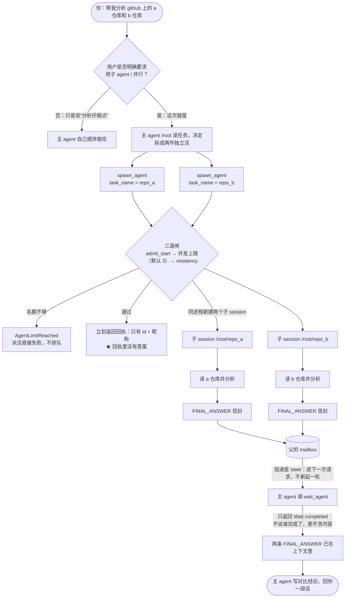

# 多 Agent 架构

Orbit 在 Pi 1.3.0 之上加了一层「协作控制面」。干活仍然是 Pi：每个 agent 都是一个真的 Pi 进程；父子的生命周期、消息投递和界面显示由 Orbit 负责。

## 先用一个例子讲清

下面所有机制，都可以挂在这一个场景上。

你对主 agent 说：

> 帮我分析 github 上的 a 仓库和 b 仓库

先看整张图，再逐条解释：



下面按顺序走一遍。

**第 1 步：主 agent 读一下，决定怎么拆**

主 agent 就是你在对话里直接说话的那一个，它的固定路径是 `/root`。它看到这是两件互不依赖的活，于是连着调两次 `spawn_agent`，每次给子 agent 起一个名字：`repo_a`、`repo_b`。

**第 2 步：派活立刻返回，回执里没有答案**

两次调用都是秒回，回给你的东西只有一行：

```text
/root/repo_a (agent_id: 7c1e) 已启动，结果稍后以消息形式送达
```

这是整套设计里最反直觉的一点：**派活返回的是回执，不是成果**。

**第 3 步：两个子 agent 真的同时在跑**

`/root/repo_a` 和 `/root/repo_b` 是两个独立的 Pi 进程，但都在**同一个项目目录**里。它们各自去读自己的仓库、各自分析，互不等待。

**第 4 步：子 agent 干完，结果自己飞回来**

`repo_a` 跑完之后，它最后那段总结会被装进一个信封，**自动注入到主 agent 的对话里**：

```text
Message Type: FINAL_ANSWER
Task name: /root
Sender: /root/repo_a
Status: completed
Payload:
a 仓库主要用的是……（子 agent 的最终回答）
```

对主 agent 来说，这跟你自己发了一条消息没什么区别，它就是普通上下文里的一条消息。

**第 5 步：主 agent 去「敲门」看谁交了活**

主 agent 会调用 `wait_agent(timeout_ms)`。它拿到的只有一句 `Wait completed.`，**连谁完成了都不说，更不包含内容**。内容就是第 4 步那个信封。

这也是为什么「子 agent 的成果永远不会出现在工具返回值里」——工具只负责告诉你信箱里有信，不负责把信念出来。

**第 6 步：主 agent 综合**

它把两个信封读完，写出一段对比结论给你。你只看到最后这一条回答，但中间是两个 agent 并行干出来的。

后面每一节，都是给这个例子补上机制部分。

## 运行时模型

主 Pi 会话拿到的协作工具就是这 6 个：

- `spawn_agent`
- `send_message`
- `followup_task`
- `wait_agent`
- `interrupt_agent`
- `list_agents`

**故意没有「批量派活」工具**。因为派活本身不阻塞，要并行就在同一轮里连着调几次 `spawn_agent`，它们会同时启动。在非阻塞的派活上再套一个批量原语是多余的。

除了准入之外没有任何调度策略——没有队列、没有批量原语、也没有树深度上限。派不派、派几个、子 agent 要不要再往下派，全都由主模型自己决定。被约束的有三样：

- **整棵树最多 8 个 worker 同时运行**（`MAX_ACTIVE_CHILDREN`）。这是**全树共享**的额度，不是每层各一份：嵌套派活不会把 8 乘成 8×N。
- **每个进程最多保留 12 个存活 worker**（`MAX_LIVE_CHILDREN`），超出按「最先结束的先清理」淘汰。
- **结束后空闲超过 10 分钟就回收**，不必等到攒满 12 个。

前两项之外还有一个跨进程的闸门。worker 是独立进程，所以"全树共享"靠文件系统实现：每个正在运行的 worker 在树目录下占一个槽文件（`TreeSlots`），派活前必须取到一个，取不到就报错而不是排队。槽文件名带着占位进程的 pid，进程崩溃留下的槽会在下一次派活时被回收，所以配额不会被死进程永久吃掉。默认额度是 8，可用 `PI_GUI_AGENT_TREE_LIMIT` 调整；目录通过 `PI_GUI_AGENT_TREE_DIR` 传给子 agent。

### Agent 路径

每个 agent 都有一个固定路径，沿用 Codex 的 `AgentPath`：主 agent 是 `/root`，用 `task_name` 派出来的子 agent 则是 `<派出者路径>/<task_name>`。上面例子里就是 `/root/repo_a`。

子 agent 会被告知自己的路径，同时通过环境变量 `PI_GUI_AGENT_PATH` 拿到它，并在自己派活时继续往下传，所以多层嵌套的树不会串路径。

路径段只允许小写字母、数字和下划线；`root`、`.`、`..` 是保留字，出现 `/` 会被拒绝。名字不合法时**派活直接报错，而不是悄悄改名**——模型要的名字就是它得到的名字。

定位目标支持三种写法：agent id、绝对路径（`/root/a/b`）、相对调用者的引用（`b`），与 Codex 的 `AgentPath::resolve` 一致。`list_agents` 按真实路径前缀过滤。

每个子 agent 都是一个独立的 Pi RPC 进程，用的是 Orbit 内置的那份 Pi 运行时。子 agent 默认继承父的模型和 thinking 级别，也可以在这次派活里覆盖。子进程有自己持久的会话目录，并且只加载一个最小扩展；普通用户扩展和项目扩展在该进程里是关闭的，避免重复注册。这个最小扩展仍然暴露协作工具，所以子 agent 还能继续往下派。

worker 同时保留几个「有实际能力」的内置扩展。`--no-extensions` 一个开关同时关掉了扩展**发现**和内置扩展——这正是防止 Orbit 自己的 GUI 扩展在 worker 里又注册一遍的关键，但它也顺手剥掉了 MCP、codemode、tool search 和本地模型提供方。因此这四项被显式加回来（`--extension builtin:mcp`、`builtin:codemode`、`builtin:tool-search`、`builtin:llama.cpp`）。worker 通过 codemode 访问 `mcp.json` 里的 MCP 服务器，和主 agent 默认行为一致。扩展发现始终是可关的，所以 worker 里不会出现任何 GUI 命令。

## 结果怎么送回来

`spawn_agent` 只返回一个确认——子 agent 的固定路径和 id，**永远不是它的答案**。当子 agent 这一轮走到终态时，`SubagentRuntime` 把结果交给宿主，由宿主用 `pi.sendMessage(..., { triggerTurn: true })` 注入：

```text
Message Type: FINAL_ANSWER
Task name: <收件人路径>
Sender: <worker 路径>
Status: <completed | failed | aborted>
Payload:
<worker 的最终回答，超过 50 KB 会被截断并附一句提示>
```

派发任务时用的是同一个信封、反方向：

```text
Message Type: NEW_TASK
Task name: <worker 路径>
Sender: <派出者路径>
Payload:
<任务内容>
```

`triggerTurn: true` 在两种情况下都正确：主 agent 正在跑的时候，Pi 会把这条消息 steer 进它下一次请求，所以 `wait_agent` 一返回，模型立刻就能看到结果；主 agent 空闲的时候，Pi 直接起一轮，所以结果不会被搁在那儿没人看。

这也解释了 `wait_agent` 的语义：它只等一个**信号**，返回的文案与 Codex 逐字一致（`Wait completed.` / `Wait interrupted by new input.` / `Wait timed out.`），**从不返回内容**。谁完成了只在结构化数据（快照和返回的节点列表）里，不给模型看，免得它去工具返回值里找结果。用户中途插话会以 `Wait interrupted by new input.` 结束等待，而不是白等到超时。

## 子 agent 拿到什么上下文

`spawn_agent` 接受 `context: "inherit" | "isolated"`，默认 `inherit`。选 inherit 时，子 agent 用 Pi 的 `--fork <source>` 启动，Pi 会把父会话的条目复制到子 agent 自己会话目录下的新会话里，并在头部保留 `parentSession` 血缘。Orbit 从不把对话重新序列化塞进提示词。

fork 的来源是**过滤过的**，对应 Codex 的 `keep_forked_rollout_item`：先把主 agent 的条目重写成一棵「没有工具记录」的对话树。保留的是用户的每一轮话和助手的正文；丢掉的是工具结果、助手内容里的工具调用、思考块、压缩记录，以及 agent 之间的消息。保留下来的条目会被接成一条线性的 `parentId` 链，这样 Pi 仍然能往回走历史。

绝大部分节省就来自这里。工具结果——文件内容、diff、命令输出——占了编码会话字节数的大头，而 worker 完全可以自己再读一遍。在真实会话上测过：纯代码会话能缩掉 93–97%；以 base64 图片为主的会话缩得少很多，因为图片存在于用户轮次里，而用户轮次是保留的。

`context: "isolated"` 则是空白开局，适合那些「带着共享历史只会增加成本和噪音」的自包含任务。上面 `repo_a` / `repo_b` 的例子如果用 isolated，两个 worker 只看得到任务那一句，看不到你们之前聊过什么。

Pi 的会话是懒持久化的（有第一条对话内容才落盘），所以如果主 agent 的会话文件还不存在，继承请求会降级成 isolated，而不是让派活失败。过滤抛错时同理：宁可退回原始会话文件，也不让这次派活失败。

因为主 agent 自己那次派活调用也属于「工具调用」被一起剥掉了，所以 fork 出来的 worker 不会看到悬空的工具调用，也就不需要补一个假的工具结果。

## 生命周期与通信

`send_message` 和 `followup_task` 对应 Codex 的两种投递模式。`send_message` 只是排进正在跑的 worker，不额外起一轮；`followup_task` 在 worker 空闲时也会起一轮。Pi 对空闲的 RPC agent 没有「只排队不起轮」的语义，所以发给**空闲** worker 的 `send_message` 会先缓存在 Orbit，等这个 worker 下一次有任务时前置拼进去。这时工具返回值会明说「该 agent 当前空闲，消息已排队」，不会谎称已投递。

目标可以用 agent id 或 task name 定位；名字有歧义时直接报错，而不是猜一个。

主 agent 会话关闭时，所有 worker 进程都会被回收；跑完的 worker 空闲 10 分钟后自动回收（`ORBIT_PI_IDLE_WORKER_TTL_MS` 可调），攒到 12 个时也会按最旧优先淘汰。**新的用户轮次不会回收任何东西**：GUI 的模式同步提示词和你的消息是并发发出的，如果在这时候回收，可能正好撞上派活、把活着的 worker 杀掉。进程压力只靠淘汰来兜底，而淘汰只碰已经结束的 worker。取消会先发 Pi 的 `clear_queue` 和 `abort`，再终止进程。子会话会持久化，结束后可以从活动面板打开。

## 共享工作目录

树里每个 agent 都在**同一个工作目录**里跑，看到同一个文件系统，所以某个 worker 的改动，主 agent 和它的兄弟 agent 立刻就能看见。编排指令里明确写了这一点，同时也写了并发额度和「用长等待代替轮询」的建议。Codex 也是同样的处理方式：**这是给模型的警告，不是运行时锁**。Orbit 比 Codex 多一句——不要静默回滚别的 agent 的改动——因为共享目录真正会产生的失败就是这一种。

回到例子：如果只是读这两个仓库，共享目录没有任何风险；但如果让两个 worker 都去改同一个文件，后写的会覆盖先写的，运行时不加锁。

## 事件流

```text
父模型
  -> 协作工具
  -> SubagentRuntime
  -> 子 Pi RPC 进程
  -> Pi 的消息 / 工具 / 生命周期事件
  -> 带版本号的 AgentSnapshot
  -> 扩展 setStatus("gui-agents")
  -> Tauri JSONL 桥
  -> Zustand 状态投影
  -> 时间线里内嵌的 AgentActivityFeed
```

`AgentSnapshot` 是运行时和 React 之间**唯一的**线上契约。UI 严格解析它，不去猜别名。嵌套的快照会挂到派出它的父节点上，从而形成真正的 agent 树。

Pi 那些只发增量的 `message_update`、`tool_execution_*`、`message_end`、`agent_end`、`agent_settled` 事件，驱动实时摘要和终态。快照发布做了 64 ms 的尾随节流，免得每个 token 都触发一次 webview IPC 和渲染。

## 内置 Pi

`scripts/bundle-pi.mjs` 把锁定的 `@earendil-works/pi-coding-agent` 打成一个自包含的 Node bundle，并准备好主题、HTML 导出资源和 Photon 资源。Tauri 优先解析这个应用资源，只有在兼容场景下才回退到项目级或全局的 Pi。父进程和子进程通过 `ORBIT_PI_*` 环境变量拿到同一份 CLI 与 Node 路径。

所以用户不需要另外装 Pi。桌面应用仍然需要一个兼容的 Node 运行时。

## Pi API 覆盖

主集成保留了对 Pi 全部 33 个 RPC 命令的类型化覆盖。多 agent 运行时只用适合控制子进程的那一部分：prompt/steer/follow-up、状态、流式消息、工具执行、清队列、中止、会话持久化。它不会为了「和父 API 一样全」而去转发无关命令。

输入框上的 **Pi / Multi Agent** 分段控件把整套协作工具当作一个能力整体来开关。新安装默认是 Pi 模式，用户的选择会被持久化。工具清单来自同一份导出的协议列表，所以扩展命令和实际注册的工具面不会各说各话。

## 没有从 Codex 搬过来的部分

Codex 有两个协作功能 Orbit 没有实现，另有两处差异：

- **消息板**——Codex 有频道、帖子、订阅和搜索（`create_channel`、`post`、`subscribe`……），可选 SQLite 持久化。Pi 没有对应的频道模型，要做得另立项目。
- **命名角色**——Codex 从 TOML 加载 `agent_type` 定义，可以改变子 agent 的模型、指令和功能开关。Orbit 只支持在派活时覆盖 model / thinking。
- **会话级临时 MCP 服务器。** 持久化到 `~/.pi/agent/mcp.json`（或受信任项目的 `.pi/mcp.json`）的服务器，worker 也能用，因为内置 MCP 扩展读的是同一批文件。但通过 `/gui-mcp add` 为某次会话临时注册的服务器只活在主 agent 的进程内存里，worker 看不到。
- **并发编辑。** Codex 的主 agent 和 worker 共享一个工作目录、可能并发编辑。Orbit 现在也不阻塞主 agent，所以同样的风险存在：运行时不会把仓库写入串行化。主 agent 和每个 worker 都会被明确告知这一点——和 Codex 注入的是同一段提示——包括「别的 agent 的改动立刻可见」「不要静默回滚别人的改动」「同时允许多少个 worker」。两边都只是提示，不是强制。

`tsconfig.subagents.json` 对这个目录做类型检查；它独立于应用配置，命令是 `check:subagents`。
