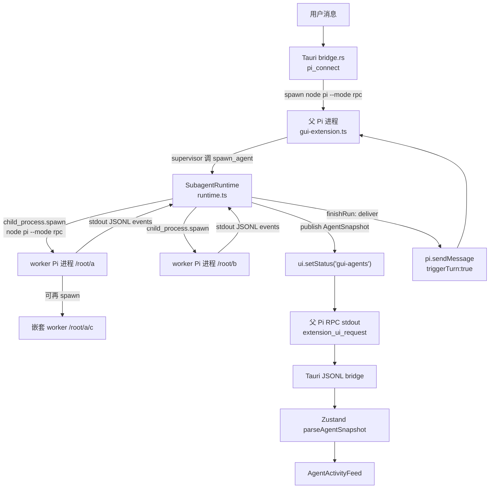

# Orbit / Pi 多 agent 实现原理分析

> 分析对象：Orbit 在 Pi 之上实现的多 agent 协作控制面（成文时锁 Pi 1.0.0，现基线已升至 1.3.0，见 `docs/CAPABILITIES.md` 的「Pi 1.3.0 升级备注」）。
> **范围说明：** 本文描述的是 Codex V2 工具面的对齐实现；对照基准见 `docs/analysis/multi-agent-comparison.md`。
> 证据分级：
> - 【源码】= 本地源码 `/Users/work/pi-gui/src-tauri/resources/subagents/`（以及 `src-tauri/src/bridge.rs`）。
> - 【文档】= `/Users/work/pi-gui/docs/MULTI_AGENT.md`、`docs/CAPABILITIES.md`、`docs/SOURCES.md`。
> - 【运行时】= 本会话自身运行在 pi harness 的 supervisor/worker 模式中可观察到的一手行为。
> - 【打包产物】= `/Applications/Orbit.app/Contents/Resources/resources/pi-runtime/` 下的 minified bundle；**非源码**，仅用于交叉确认 Pi 侧的 RPC/事件语义。
>
> 该目录下**没有** README 或 docs，也没有 `src/`/`lib/`（只有 `dist/`、`cli-*.js`、`node_modules/`）。Pi 的文档实际位于
> `/Users/work/pi-gui/node_modules/@earendil-works/pi-coding-agent/docs/`。这一点与任务描述不同，已在下方标注。

---

## 1. 一句话结论

Orbit 的多 agent 是**「一个父 Pi 进程 + N 个独立的子 Pi RPC 进程」的异步委派模型**：
父进程通过一个最小化扩展（`registerSubagentTools`）暴露 6 个协作工具；`spawn_agent` **不阻塞**，只返回子 agent 的 canonical path/id；子进程完成后，`SubagentRuntime` 把结果以 `FINAL_ANSWER` 文本消息经 `pi.sendMessage(..., { triggerTurn: true })` 注入父对话，父在下一轮请求（或空闲唤醒）里看到结果。agent 树用 `AgentNode` 的 `path`（`/root/<task_name>`）作为稳定身份，`childrenIds`/嵌套快照维护父子关系；并发用「最多 8 个活跃 worker + 12 个存活进程后按最旧已结束者驱逐」做背压，但没有队列、没有树深度限制、没有沙箱，所有 agent 共享同一 cwd 与文件系统。

---

## 2. 关键代码 / 文档位置表

| 路径:行号 | 作用 |
|---|---|
| `src-tauri/resources/subagents/runtime.ts:101` | `MAX_ACTIVE_CHILDREN = 8`：并发硬上限（spawn 时校验） |
| `src-tauri/resources/subagents/runtime.ts:103` | `MAX_LIVE_CHILDREN = 12`：存活进程上限，超出后驱逐最旧已结束者 |
| `src-tauri/resources/subagents/runtime.ts:120` | 子进程保留的 4 个内置扩展：`builtin:mcp`/`codemode`/`tool-search`/`llama.cpp` |
| `src-tauri/resources/subagents/runtime.ts:148-153` | `modelVisibleOutput`：模型可见输出截断到 50KB |
| `src-tauri/resources/subagents/runtime.ts:180-201` | `makeTaskPrompt`（NEW_TASK 信封）/ `resultText` |
| `src-tauri/resources/subagents/runtime.ts:235` | `selfPath` 取 `PI_GUI_AGENT_PATH`，缺省为 `/root`：worker 自己继承路径 |
| `src-tauri/resources/subagents/runtime.ts:240` | `sessionBaseDir = <parent session dir>/subagents` |
| `src-tauri/resources/subagents/runtime.ts:331,400` | `setFromNestedSnapshot`：从子进程 `setStatus("gui-agents")` 事件重建嵌套树 |
| `src-tauri/resources/subagents/runtime.ts:345-450` | `handleEvent`：解析 `message_update`/`tool_execution_*`/`message_end`/`agent_settled`/`agent_end`/`get_state` 响应 |
| `src-tauri/resources/subagents/runtime.ts:406-421` | `agent_settled` → 置终态并调用 `finishRun`（一次 run 只上报一次） |
| `src-tauri/resources/subagents/runtime.ts:453-473` | `forkSource`：inherit 时生成过滤后的 `fork-source.jsonl`；缺失/失败降级 |
| `src-tauri/resources/subagents/runtime.ts:475-494` | `evictSettledWorkers`：只驱逐已结束者，最旧优先 |
| `src-tauri/resources/subagents/runtime.ts:496-505` | `finishRun`：通知 `wait_agent` 等待者 + `deliver(node, output)` |
| `src-tauri/resources/subagents/runtime.ts:507-641` | `createChild`：拼 CLI 参数、`spawn()`、stdin/stdout JSONL 泵 |
| `src-tauri/resources/subagents/runtime.ts:530-538` | 进程外启动：`node:child_process.spawn`，cwd + 环境变量 `PI_GUI_AGENT_*` |
| `src-tauri/resources/subagents/runtime.ts:642-663` | `request()`：带超时的 RPC 请求（默认 30s） |
| `src-tauri/resources/subagents/runtime.ts:664-680` | `stopProcess`：`clear_queue`(5s) → `abort`(15s) → SIGTERM(5s) → SIGKILL(1s) |
| `src-tauri/resources/subagents/runtime.ts:682-753` | `spawn()`：校验名字/并发 → 建节点 → 起进程 → `get_state` → `prompt` → **立即返回 ack** |
| `src-tauri/resources/subagents/runtime.ts:755-796` | `waitForUpdate()`：只等信号，返回摘要，不含内容 |
| `src-tauri/resources/subagents/runtime.ts:798-842` | `send()`：`steer` vs `followUp`；空闲时的 steer 落 `queued` |
| `src-tauri/resources/subagents/runtime.ts:857-880` | `resolveAgentId`：id → 绝对路径 → 相对路径 → 唯一 name |
| `src-tauri/resources/subagents/runtime.ts:882-887` | `liveAgentNames()`：未被驱逐且可接受工作的 agent |
| `src-tauri/resources/subagents/runtime.ts:889-895` | `interrupt()` → `stopProcess` |
| `src-tauri/resources/subagents/runtime.ts:928-935` | `beginUserTurn`：新一轮不清 worker，只清 mailbox + 重发快照 |
| `src-tauri/resources/subagents/runtime.ts:936-944` | `dispose()`：session_shutdown 时回收全部子进程 |
| `src-tauri/resources/subagents/tools.ts:16-23` | `SUBAGENT_TOOL_NAMES`：与 Codex V2 对齐的 6 工具 |
| `src-tauri/resources/subagents/tools.ts:40-47` | `SHARED_AGENT_NOTES`：共享目录 + 并发 8 的提示词注入 |
| `src-tauri/resources/subagents/tools.ts:51-76` | supervisor / child 两套 orchestration system prompt |
| `src-tauri/resources/subagents/tools.ts:130-140` | `resultMessage()`：组装 FINAL_ANSWER 信封 |
| `src-tauri/resources/subagents/tools.ts:142-171` | `runtimeFor()`：`deliver` → `pi.sendMessage(..., {triggerTurn:true})` |
| `src-tauri/resources/subagents/tools.ts:184-206` | `spawn_agent` 工具定义与 ack 文案 |
| `src-tauri/resources/subagents/tools.ts:208-233` | `send_message`(steer) / `followup_task`(followUp) |
| `src-tauri/resources/subagents/tools.ts:235-258` | `wait_agent`：默认 30s，最大 600s |
| `src-tauri/resources/subagents/tools.ts:278-303` | `list_agents`：`path_prefix` 前缀过滤 |
| `src-tauri/resources/subagents/tools.ts:305-314` | `input` handler（beginUserTurn，排除 streaming/extension）+ `before_agent_start` 注入 |
| `src-tauri/resources/subagents/paths.ts:20-29` | `validateAgentName`：小写字母/数字/下划线，保留 `root`/`.`/`..` |
| `src-tauri/resources/subagents/paths.ts:55-60` | `joinAgentPath` |
| `src-tauri/resources/subagents/paths.ts:66-74` | `resolveAgentPath` |
| `src-tauri/resources/subagents/fork.ts:114-200` | `filterForkSession`：过滤 toolResult/toolCall/thinking + parentId 线性化 |
| `src-tauri/resources/subagents/types.ts:1-46` | `AgentNode`/`AgentSnapshot`（version:1）wire 契约 |
| `src-tauri/src/bridge.rs:3097-3100` | 父 Pi 进程由 Tauri 启动：`--mode rpc --offline --extension gui-extension.ts` |
| `src-tauri/src/bridge.rs:607-616` | `ORBIT_PI_CLI_PATH` / `ORBIT_PI_NODE_PATH` 传给父与子 |
| `src-tauri/resources/gui-extension.ts:1050` | 父扩展注册子 agent 工具 |
| `src-tauri/resources/gui-extension.ts:1109-1111` | `gui-agent-mode` 命令：整体增删 6 个协作工具 |
| `docs/MULTI_AGENT.md:20-103` | 架构总述（并发/路径/投递/上下文/生命周期/共享目录/事件流） |
| `docs/CAPABILITIES.md:46` | 能力表中「动态多 agent」条目 |
| `docs/SOURCES.md:21` | P5：官方 `examples/extensions/subagent/` 是本实现的执行基础 |
| `tests/subagent-runtime.test.ts:188-552` | 委派/继承/寻址/回收/投递的运行时行为测试（18 项） |
| `node_modules/@earendil-works/pi-coding-agent/docs/rpc-commands.md:20-128` | Pi RPC `prompt.streamingBehavior`/`steer`/`follow_up`/`clear_queue`/`abort`/`get_state` 语义 |
| `node_modules/@earendil-works/pi-coding-agent/docs/cli.md:94-107,185-187` | `--fork`、`--session-dir`、`--no-extensions` + `-e builtin:*` |
| `node_modules/@earendil-works/pi-coding-agent/docs/session-format.md:72-75` | fork 后 session 头写 `parentSession` |
| `/Applications/.../pi-runtime/cli-rergzcqa.js:123672-123688`【打包产物】 | RPC `case "prompt"`：**preflight 即回 `success`**，不等完成 → 支撑「spawn 立即返回」 |
| `/Applications/.../pi-runtime/cli-rergzcqa.js:100857-100866`【打包产物】 | `pi.sendMessage` 的 `triggerTurn`/`deliverAs`/流式 steer/followUp 分支 |
| `/Applications/.../pi-runtime/cli-rergzcqa.js:123701-123727`【打包产物】 | `clear_queue`/`abort`/`get_state` RPC handler 本体 |
| `/Applications/.../pi-runtime/cli-rergzcqa.js:100013-100014`【打包产物】 | `agent_settled` 事件发射点 |

---

## 3. 架构与数据流图



嵌套树的补充链路：子进程自己也注册了协作工具（`entry.ts`），它调用 `ctx.ui.setStatus("gui-agents", snapshot)` 时，该 `extension_ui_request` 事件经**父进程读取子进程 stdout** 被 `handleEvent` 捕获（`runtime.ts:400`），再经 `setFromNestedSnapshot`（`runtime.ts:331`）挂到对应父节点上，从而在 UI 上形成真正的 agent 树。也就是说，父子之间没有第二条控制通道，复用同一套 RPC event stream。

```mermaid
sequenceDiagram
  participant M as 父模型
  participant RT as SubagentRuntime
  participant P as 子 Pi 进程
  M->>RT: spawn_agent(task_name, message, context)
  RT->>RT: validateAgentName + 8 并发检查
  RT->>P: spawn(node pi --mode rpc --no-extensions<br/>-e builtin:* -e entry.ts [--fork src] [--model/--thinking])
  RT->>P: {"type":"get_state"}
  P-->>RT: {model, sessionFile, pid...}
  RT->>P: {"type":"prompt","message": NEW_TASK 信封}
  P-->>RT: {"command":"prompt","success":true} (preflight)
  RT-->>M: tool result = "path (agent_id) started"（无答案）
  Note over P: worker 执行中，stdout 持续发 message_update/tool_execution_* 事件
  P-->>RT: {"type":"agent_settled"}
  RT->>RT: status=completed/failed/aborted; finishRun()
  RT->>M: pi.sendMessage(FINAL_ANSWER, triggerTurn:true)
  M->>RT: wait_agent(timeout) （只拿到摘要信号）
```

---

## 4. 从 spawn 到 FINAL_ANSWER 的完整时序

1. **模型调用 `spawn_agent`**（`tools.ts:184`）。`taskOptions` 把 `task_name/message/cwd/model/thinking/context` 归一化；`model` 默认取父的 `ctx.model`，`thinking` 默认取父的 `ctx.thinkingLevel`，`context` 默认 `inherit`（`tools.ts:113-126`）。【源码】
2. **`SubagentRuntime.spawn`**（`runtime.ts:682`）：
   - 拒绝空 task；用 `validateAgentName` 校验 `task_name`，**不合法就报错而不是改写**（`runtime.ts:686-688`，`paths.ts:20`）。
   - `snapshot().active.length >= 8` 直接抛「子 agent 并发数不能超过 8」（`runtime.ts:690`）——**没有排队**。
   - `evictSettledWorkers()`：存活进程已 ≥12 时，按 `endedAt` 最旧先驱逐已结束者（`runtime.ts:475`）。【源码】
3. **建节点**（`runtime.ts:305-328`）：`id=randomUUID()`，`path = joinAgentPath(parentPath, name)`，`status="queued"`→`"running"`；通过 `attachChild` 写入父的 `childrenIds`。【源码】
4. **`createChild` 起独立进程**（`runtime.ts:507-641`）：
   - 命令：`<node> <pi> --mode rpc --offline --no-extensions -e builtin:mcp -e builtin:codemode -e builtin:tool-search -e builtin:llama.cpp -e <subagents/entry.ts>`。
   - `--no-extensions` 关掉**扩展发现**（防止 GUI 扩展在 worker 里递归注册），但显式 `-e builtin:*` 把能力加回来（`runtime.ts:120,507-515`；文档 `MULTI_AGENT.md:30-34`）。
   - `--session-dir <parentSessionDir>/subagents/<agentId>`（`runtime.ts:517-521`）。
   - `inherit` 时 `--fork <forkSource>`（`runtime.ts:525-526`）。
   - `--model` / `--thinking` 仅在显式覆盖时附加（`runtime.ts:527-528`）。
   - 环境注入 `PI_GUI_SUBAGENT=1`、`PI_GUI_AGENT_ID`、`PI_GUI_AGENT_PATH=node.path`、`PI_GUI_AGENT_PARENT_ID`（`runtime.ts:533-538`）。【源码】
5. **握手**：`get_state`（30s 超时）读回 model / sessionFile / pid；再发 `prompt`，消息体是 `NEW_TASK` 信封（`messageType/taskName/sender/payload`，`runtime.ts:180-201, 715-720`）。inherit 时信封尾部追加「你已继承父 agent 的完整对话上下文」提示。【源码】
6. **立即返回 ack**：Pi 的 RPC `prompt` 是 **preflight 成功即回 response**（【打包产物】`cli-rergzcqa.js:123672-123688`），`request` 一收到 response 就 resolve。因此 `spawn_agent` 的 tool result 只有 `"<path> (agent_id: <id>) started..."`，**绝不含答案**（`tools.ts:198-205`；测试 `tests/subagent-runtime.test.ts:189-206`）。【源码+打包产物】
7. **运行期事件**：父侧 `handleEvent`（`runtime.ts:345`）消费子进程 stdout 的 delta-only 事件，更新 `summary`、`usage`、`sessionId`、`pid`；每 64ms trailing-throttle 发布一次 `AgentSnapshot`（`runtime.ts:265-283`；`MULTI_AGENT.md:102`）。【源码】
8. **终态**：子进程 `agent_settled`（【打包产物】`cli-rergzcqa.js:100013`）→ 依据 `handle.failure` 或输出把状态定为 `completed`/`failed`/`aborted`，写 `endedAt`，置 `settledDone`（`runtime.ts:406-421`）。注意 `agent_settled` 只代表**空闲**，不代表进程退出（`runtime.ts:668-669` 注释）。【源码】
9. **`finishRun`**（`runtime.ts:496-505`）：把节点推入 `updates`、唤醒 `waiter`（使 `wait_agent` 返回），并调用 `deliver(node, output)`。
10. **投递**：`deliver` 是 `tools.ts:157-170` 里的 `pi.sendMessage({customType:"subagent_result", display:true, content:[FINAL_ANSWER 信封]}, { triggerTurn: true })`。【源码】
11. **父侧消费**：`triggerTurn:true` 时——父正在流式运行 → Pi `steer` 注入下一次请求；父空闲 → 直接起一轮（`cli-rergzcqa.js:100857-100866`【打包产物】；`MULTI_AGENT.md:57`）。`wait_agent` 只返回「哪些 worker 有更新」的摘要（`runtime.ts:755-796`，测试 `tests/subagent-runtime.test.ts:208-231`）。【源码】

---

## 5. 三类机制细节

### 5.1 并发与调度

- **进程外**：`import { spawn } from "node:child_process"`（`runtime.ts:2`），每个 worker 是独立 Node/Pi 进程；父 Pi 自身也是 Tauri 通过 `Command::new(node).arg(pi).args(["--mode","rpc","--offline","--extension", gui-extension.ts])` 起的独立进程（`bridge.rs:3097-3100`）。【源码+运行时观察】
- **并发上限 8**：spawn 时硬校验，超限报错；上限值同时被写进 `SHARED_AGENT_NOTES` 提示词（`runtime.ts:101,690`；`tools.ts:40-47`）。这是**每进程独立**的上限——嵌套树里每个 worker 各有自己的 `SubagentRuntime` 和 8 个槽，所以**全树活跃数没有全局上限，也没有深度上限**（`MULTI_AGENT.md:20` 明确说「无人工 tree-depth limit」）。【源码】
- **没有队列**：`status:"queued"` 只是建节点到置 running 之间的瞬时态；超限是拒绝而不是排队。【源码】
- **存活进程上限 12**：只驱逐已结束者，最旧优先（`runtime.ts:103,475-494`）。已结束的 worker 进程默认**保留**，以便 `send_message`/`followup_task` 复用（见 5.3）。【源码】
- **超时**：RPC 请求默认 30s（`get_state`/`prompt`/`send` 都用 30s）；`wait_agent` 默认 30s、最大 600s（`runtime.ts:642,122,715-720`；`tools.ts:28-29,254`）；停止流程 `clear_queue` 5s / `abort` 15s / SIGTERM 后等 5s / SIGKILL 后等 1s（`runtime.ts:667-677`）。【源码】
- **模型/thinking 传递**：默认继承父的 `ctx.model`/`ctx.thinkingLevel`，spawn 参数可覆盖，最终以 CLI `--model`/`--thinking` 传给子进程（`tools.ts:113-126`；`runtime.ts:527-528`）；thinking 取值集合 `off|minimal|low|medium|high|xhigh|max`（`tools.ts:71`）。【源码】
- **一轮不清 worker**：`beginUserTurn` 只清 `updates` mailbox 并立即重发快照，**不杀任何进程**（`runtime.ts:928-935`），因为 GUI 的 mode-sync prompt 与用户消息并发，清理会竞态杀活（测试 `tests/subagent-runtime.test.ts:403-418`）。【源码】

### 5.2 上下文继承（inherit vs isolated）

- **`isolated`**：`forkSource` 直接返回 `undefined`（`runtime.ts:454-455`），子进程不传 `--fork`，是空 session，只看到 `NEW_TASK` 信封里的 task 文本（`makeTaskPrompt`，`runtime.ts:180-194`）。【源码】
- **`inherit`（默认）**：`--fork <source>`，Pi 把父 session 的 entry 拷进**子自己的 session 目录**，并在 header 保留 `parentSession` 血缘（`runtime.ts:522-526`；`session-format.md:72-75`；`MULTI_AGENT.md:63`）。Orbit **从不把对话重新序列化进 prompt**（`tools.ts:91-93` 注释 & `runtime.ts:187-192`）。【源码+文档】
- **fork 源被过滤**：`filterForkSession`（`fork.ts:114`）模仿 Codex 的 `keep_forked_rollout_item`：
  - 保留：`user`/`system` message、assistant 的 `text` 块。
  - 丢弃：`toolResult` message、assistant content 里的 `toolCall`/`thinking` 块、以及所有非 `message` entry（compaction、usage、label、custom、model/thinking change 等）（`fork.ts:71-108,150-178`）。
  - **`parentId` 线性化**：因为 Pi 靠 `parentId` 链从叶子回溯活动 transcript，丢弃后必须把幸存 entry 重连成一条线性链，否则孤儿之后全部静默消失（`fork.ts:15-23,182-188`）。【源码】
  - 过滤后的文件写在自己的 session 目录下 `fork-source.jsonl`，只作 fork 源、不是 worker 的 session（`runtime.ts:462-470`；测试 `tests/subagent-runtime.test.ts:275-311`）。【源码】
- **降级**：父 session 文件不存在（Pi 懒持久化）→ 退化为 isolated；过滤抛错 → 用原始 session 文件（`runtime.ts:453-472`）。两条降级都记为显式设计，不是错误。【源码】
- **system prompt 传递**：不是拷贝，而是由 `before_agent_start` 钩子在子进程里**追加**对应的 orchestration 段；用 `PI_GUI_SUBAGENT === "1"` 区分 supervisor / child 文案，且仅当协作工具处于 active 时才注入（`tools.ts:310-314`；`tools.ts:51-76`）。【源码】
- **工具集**：子进程保留 4 个内置能力扩展 + 最小 `entry.ts`；`entry.ts` 注册协作工具，并额外启用 ripgrep 版搜索工具（`entry.ts:1-10`）。父扩展的其余 GUI/MCP 临时注册能力不会进 worker（`MULTI_AGENT.md:34-40`）。注意：`gui-mcp add` 这类**会话内存里的 MCP 服务器**在 worker 里看不到（`MULTI_AGENT.md` "Not carried over" 段）。【源码+文档】

### 5.3 消息机制

- **`spawn_agent` 立即返回**（非阻塞）：见 §4 step 6。【源码+打包产物】
- **`wait_agent` 只等信号**：`waitForUpdate` 在 `updates` 非空时立即返回摘要；无 live children 返回 `"No live agents."`；超时返回 `"Wait timed out."`；**从不返回 worker 内容**（`runtime.ts:755-796`）。这与 Codex 契约一致（`MULTI_AGENT.md:59`）。【源码+运行时观察】
- **`send_message` vs `followup_task`**：都走 `runtime.send`，区别在 `mode`（`tools.ts:215-233`；`runtime.ts:798-842`）：
  - `followup_task` → `mode:"followUp"`：worker 运行中带 `streamingBehavior:"followUp"` 投递；已结束则 `resetSettled()` 后发 `prompt`，**触发新一轮**。【源码】
  - `send_message` → `mode:"steer"`：worker 运行中带 `streamingBehavior:"steer"`；**已结束时把消息塞进 `handle.queued`**，只在下次任务时前置拼接（`runtime.ts:801-804, 719`）。这是 Pi 没有「空闲时不触发 turn 的队列」导致的语义折衷，文档 `MULTI_AGENT.md:76-78` 明确承认。【源码+文档】
  - 目标解析：agent id → 绝对路径 → 相对路径 → 唯一 name，歧义即报错（`runtime.ts:857-880`）。
- **FINAL_ANSWER 投递路径**：`finishRun → deliver → pi.sendMessage(customType:"subagent_result", {triggerTurn:true})`。父空闲时唤醒一轮；父运行中 steer 进下一次请求。`display:true` 让报告在父的对话 fold 内可见，但父自己的散文仍是给用户的答案（`tools.ts:157-170` 注释）。【源码】
- **双向同信封**：下游 `NEW_TASK`（父→子），上游 `FINAL_ANSWER`（子→父），含 `Status: completed|failed|aborted`，payload 经 `modelVisibleOutput` 截到 50KB（`tools.ts:130-140`；`runtime.ts:148-153`）。【源码+运行时观察：本会话即用该格式收到 worker 结果】

### 5.4 生命周期与回收

- **完成后进程保留**：`agent_settled` 后 handle 仍在 `children` map 中（`agent_settled` 只是空闲）；只有 `interrupt`、`dispose`、或超过 12 的驱逐才 `stopProcess`（`runtime.ts:496-505,668-680,889-895,936-944`）。【源码】
- **失败传播**：`message_end` 里 assistant `stopReason==="error"|"aborted"` 记为 `handle.failure`；子进程 `error`/非零 `close` 记为 failed；spawn 握手失败在停进程前先写真实原因，避免被 "process exited with code N" 覆盖（`runtime.ts:405-421,607-637,724-733`）。`finishRun` 只对终态节点上报（`runtime.ts:496-499`）。【源码】
- **结果进入父下一轮上下文**：靠 `pi.sendMessage(triggerTurn:true)`，不是 tool result（见 §5.3）。【源码+运行时观察】
- **中断语义**：`interrupt_agent` → `stopProcess` → `clear_queue` → `abort` → SIGTERM → SIGKILL，并删除 `children` 条目；被中断节点置 `aborted`（`runtime.ts:664-680,889-895`；测试 `tests/subagent-runtime.test.ts:390-402`）。**被回收的 agent 无法再寻址**，`resolveAgentId` 会提示「agent 已被回收，请重新 spawn」（`runtime.ts:860-876`）。【源码】
- **会话持久化**：子会话在 `<parentSessionDir>/subagents/<agentId>` 下持久化，结束后可在活动面板打开（`runtime.ts:517-521`；`MULTI_AGENT.md:79`）。【源码+文档】
- **UI 投影**：快照经 `ui.setStatus("gui-agents")` → RPC `extension_ui_request` → Tauri JSONL bridge → `parseAgentSnapshot` 严格解析 → Zustand → `AgentActivityFeed`（`tools.ts:150`；`runtime.ts:281`；`src/lib/rpc-core.ts:187-192`；`src/lib/store.ts:29-31`）。`recent` 按当前 `turn` 过滤，避免旧轮 worker 沉淀到新消息 fold（`runtime.ts:258-263,928-935`）。【源码】

---

## 6. 设计取舍与风险

**架构取舍（有意为之）**

- **异步委派 + 无 batch spawner**：因为 spawn 不阻塞，并行即「一个 turn 内多次 `spawn_agent`」，再给批量原语是冗余（`tools.ts:16-23`；`MULTI_AGENT.md:12-18`）。好处是父不被阻塞、可继续工作；代价是模型必须理解「答案不在 tool result 里」这一非直觉契约（靠 `promptGuidelines` 与 system prompt 反复强调）。
- **子进程而非进程内 agent**：每个 worker 是完整 Pi 进程，天然隔离故障与上下文窗口，可独立 `--model/--thinking`，可持久化子会话；代价是每个进程启动/内存/工具 schema 的固定成本。
- **fork 而不是重序列化**：把历史拷贝交给 Pi 自己的 session 机制，Orbit 只做过滤；能保留 `parentSession` 血缘、忠实保留 Pi 的多模态与消息语义。
- **无沙箱、共享 cwd**：与 Codex 一致，这是刻意的。约束是「给模型的警告」而不是运行时锁（`docs/MULTI_AGENT.md:81-84`；`tools.ts:40-47`）。

**风险 / 未确认点**

1. **共享文件系统竞态（高）**：所有 agent 同 cwd、同文件系统，**运行时不做任何写串行化**（`runtime.ts:531`；`tools.ts:40-47`）。docs 明确承认这一点（`MULTI_AGENT.md:81-84`）。「不要静默回滚别人的改动」只是提示词，不保证。
2. **无隔离沙箱（高）**：子进程继承 `process.env` 与 cwd（`runtime.ts:533-538`），可读写同一台机器任意路径、执行任意命令。没有权限边界，也没有 per-worker worktree。
3. **Token 成本放大（高）**：默认 `inherit`，每个并发 worker 都会 fork 一份（过滤后的）父历史并在自己的请求里重复计费。过滤（`fork.ts`）缓解了 toolResult 占大头的情况，但——(a) 过滤失败会**退回未过滤的原始 session**（`runtime.ts:465-470`），可能更贵甚至泄漏工具输出；(b) 用户消息里的 base64 图片被保留，图片密集型会话节省有限（`MULTI_AGENT.md:67`，该 93–97% 数字为文档实测声明，本次未独立复现）。并发 8 且可嵌套 → 成本可乘性放大。
4. **无全局并发/深度上限（中高）**：8/进程、无树深限制、无全局配额。嵌套树理论上可 8^n 扩张，仅靠进程驱逐兜底。`MULTI_AGENT.md:20` 把这点描述为「no artificial limit」。
5. **`send_message` 语义折衷（中）**：给**空闲** worker 的 steer 只进 `handle.queued`，若之后没有 `followup_task`/再次 spawn，这条消息**永远不投递**（`runtime.ts:801-804`；`MULTI_AGENT.md:76-78`）。模型若把它当 Codex 的 steer 用，会静默失效。
6. **背压是「报错」而非「等待」（中）**：第 9 个并发 spawn 直接抛错，模型必须自己重试/延后（`runtime.ts:690`）。没有队列，也没有「等待槽位」工具。
7. **嵌套快照走 `setStatus` 通道（低中）**：子树的 UI 投影依赖把 JSON 塞进 `statusText`，由父进程读子 stdout 的 `extension_ui_request` 解析（`runtime.ts:395-403`）。解析失败被 `catch` 静默吞掉（`runtime.ts:401-403`），届时 UI 树会缺枝但不报错。快照有 64ms 节流与 `slice(-80)` 上限。
8. **健康检查缺失（低中，未确认）**：子进程可能在 `agent_settled` 后长期存活直到 12 上限才被驱逐；未找到对空闲 worker 的主动超时回收逻辑。是否有 Tauri 侧额外的空闲回收**未确认**（`runtime.ts` 内没有）。
9. **打包产物对照有限（说明）**：`/Applications/.../pi-runtime/` 只有 minified bundle，无法逐行核对；上表中来自它的行号只用于确认 Pi 侧 RPC/事件语义，不能当作 Pi 源码。
10. **文档与实现的小张力**：`MULTI_AGENT.md:20` 称「no artificial concurrency limit」，而实现里有硬上限 8（`runtime.ts:101,690`）。二者可调和为「无排队/调度策略，只有进程压力上限」，但字面读起来不一致。
11. **与 Codex 的对照维度**（不读 Codex 仓库，仅列维度供另一 worker 对齐）：① 工具面是否同为 6 个 V2 工具；② canonical AgentPath 表示与 resolve 规则；③ fork 过滤 `keep_forked_rollout_item` 的保留/丢弃集合；④ `wait` 只回摘要的契约；⑤ `steer` vs `followUp` 两段投递；⑥ 并发上限与驱逐策略（Codex 是 `not_found` 语义）；⑦ 共享 cwd 的提示词措辞；⑧ message board / named roles / 会话级 MCP 等**Orbit 未实现**项（`MULTI_AGENT.md` 末尾段）。

---

## 7. 参考文件清单

**本项目主证据**
- `src-tauri/resources/subagents/runtime.ts`（946 行，核心）
- `src-tauri/resources/subagents/tools.ts`（320 行，工具与投递）
- `src-tauri/resources/subagents/paths.ts`（74 行，canonical path）
- `src-tauri/resources/subagents/fork.ts`（198 行，过滤 fork）
- `src-tauri/resources/subagents/types.ts`（48 行，wire 契约）
- `src-tauri/resources/subagents/entry.ts`、`index.ts`（子扩展入口/导出）
- `src-tauri/resources/gui-extension.ts:1050,1109-1111`（父扩展注册与模式开关）
- `src-tauri/src/bridge.rs:380-660,3090-3140`（父进程启动、env、JSONL bridge）
- `src/lib/agents.ts`、`src/lib/rpc-core.ts:187-192`、`src/lib/store.ts:29-31`、`src/components/agents/`（UI 投影）

**文档**
- `docs/MULTI_AGENT.md`
- `docs/CAPABILITIES.md:46`
- `docs/SOURCES.md:21`（P5）
- `tests/subagent-runtime.test.ts`、`tests/protocol.test.ts`、`tests/pi-rpc.integration.test.ts`
- `tsconfig.subagents.json`

**Pi 侧（交叉验证，非本实现源码）**
- `node_modules/@earendil-works/pi-coding-agent/docs/{rpc.md,rpc-commands.md,rpc-extension-ui.md,cli.md,sessions.md,session-format.md,extensions.md,json.md}`
- `node_modules/@earendil-works/pi-coding-agent/examples/extensions/subagent/`（官方子 agent 扩展示例，`SOURCES.md` P5 指认的执行基础）
- `/Applications/Orbit.app/Contents/Resources/resources/pi-runtime/cli-rergzcqa.js`【打包产物，minified】
- `/Applications/Orbit.app/Contents/Resources/resources/pi-runtime/` 目录本身（无 README/docs/src，仅 dist + bundle + node_modules）
