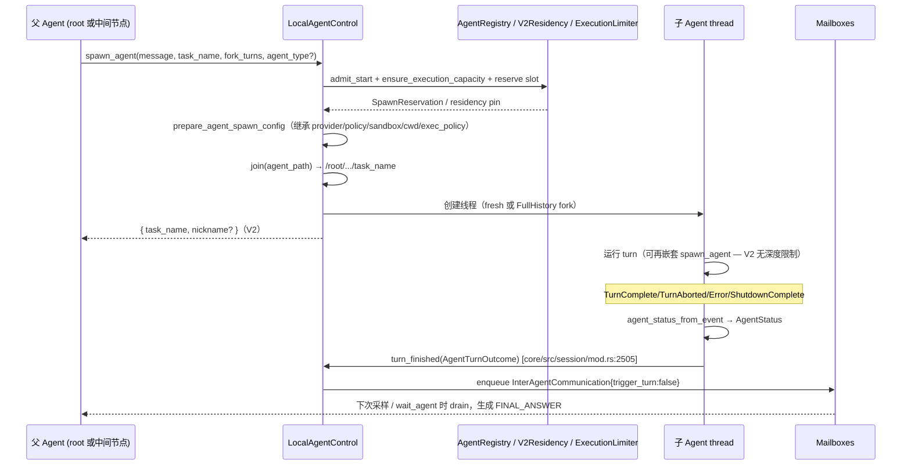
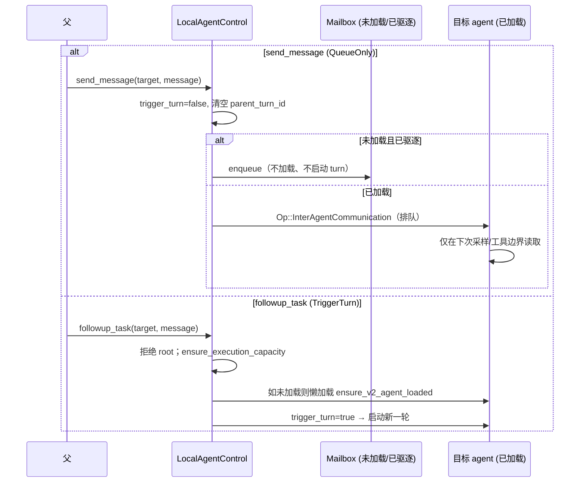

# OpenAI Codex 多 Agent / 子 Agent / 委派的实现原理

- 仓库：`/Users/work/pi-gui/vendor/codex`，commit `5009a99`（最新 main）。
- 注：仓库里的 submodule 指针仍钉在 `669449b`；本文读的是上游 main 的 `5009a99`。
- 证据路径约定：本文所有 `file:line` 均相对 `vendor/codex/codex-rs/`。
- 结论均以真实代码为依据；无法从代码确认的标注「未确认」。

---

## 1) 一句话结论

Codex 的多 agent 是**内核级子系统**，不是单纯的工具注入或 MCP 包装：它由 `AgentControl` trait + `LocalAgentRuntime`（registry / residency / mailboxes / execution limiter / rollout budget）+ `agent-graph-store` 父子边持久化 + 协议层 `AgentPath`/`AgentStatus`/`InterAgentCommunication`/`SubAgentActivity` 事件共同构成（`core/src/agent/api.rs:41`、`core/src/agent/control/runtime.rs:184`、`agent-graph-store/src/store.rs:19`、`protocol/src/protocol.rs:913`、`protocol/src/agent_path.rs:15`）。运行时由 `enum MultiAgentVersion` 选择后端，当前实现是 **V2**（task_name 路径化 + mailbox + residency 常驻，默认命名空间 `collaboration`）（`protocol/src/protocol.rs:3205`、`core/src/config/mod.rs:1641`）。它**没有**独立并发调度器/信号量，而是三套按 session-tree 共享的原子计数/队列准入（`core/src/agent/registry.rs:90`、`core/src/agent/control/execution.rs:34`、`core/src/agent/control/residency.rs:177`）。

## 2) 关键代码位置表

### 2.1 内核契约与运行时

| 文件路径:行号 | 作用 |
|---|---|
| `core/src/agent/api.rs:41` | `AgentControl` trait：spawn/send/take_mailbox/watch_mailbox/ensure_child_loaded/interrupt/list/admit_turn/record_usage/turn_finished/…（本地/远程统一契约）|
| `core/src/agent/control.rs:97` | `LocalAgentControl`：每个 root session 一个本地控制器，持有 `LocalAgentRuntime` |
| `core/src/agent/control/runtime.rs:184` | `LocalAgentRuntime`：registry / residency / mailboxes / agent_execution_limiter / rollout_budget / shutdown（整棵树共享）|
| `core/src/agent/control/spawn.rs:684` | `spawn_agent_internal`：admission → 预留 slot → fork history → 创建子线程 |
| `core/src/agent/control/spawn.rs:200` | `restore_v2_agent_metadata`：冷启动只恢复 V2 身份元数据，不重开 runtime |
| `core/src/agent/control/completion.rs:27` | `notify_parent_of_terminal_turn`：V2 子 agent 终态结果以 queue-only `InterAgentCommunication` 回传父 |
| `core/src/agent/control/mailbox.rs:26` | `Mailboxes`：每 agent 一个 `watch::Sender<bool>`，离线投递保留 |
| `core/src/agent/control/execution.rs:34` | `ensure_execution_capacity` / `execution_guard`：V2 活跃 turn 计数限流 |
| `core/src/agent/registry.rs:90` | `reserve_spawn_slot`：子 agent 数量上限（`AtomicUsize` CAS）|
| `core/src/agent/control/residency.rs:177` | V2 常驻 runtime 上限 + 空闲逐出 |
| `core/src/agent/control/interrupt.rs:19` | `interrupt_spawned_agent`：拒绝 root/self，不加载 runtime |
| `core/src/agent/role.rs:33` | `DEFAULT_ROLE_NAME` 与角色覆盖（只降权、不越权）|
| `core/src/agent/child_config.rs:104` | `build_agent_spawn_config` / 权限与运行时继承 |

### 2.2 工具层

| 文件路径:行号 | 作用 |
|---|---|
| `core/src/tools/spec_plan.rs:728` | `collab_tools_enabled`：按后端/模型决定是否暴露 agent 工具（子 agent 需自身模型也声明 V2）|
| `core/src/tools/spec_plan.rs:1438` | `add_collaboration_tools`：注册协作工具集 |
| `core/src/tools/spec_plan.rs:742` | `required_child_management_tool_names`：子管理工具名单与命名空间 |
| `core/src/tools/handlers/multi_agents_spec.rs:649` | `spawn_agent_common_properties_v2`（`task_name`/`fork_turns`/`message` encrypted）|
| `core/src/tools/handlers/multi_agents_v2/spawn.rs:36` | `spawn_agent` handler |
| `core/src/tools/handlers/multi_agents_v2/send_message.rs:12` | `send_message`（`QueueOnly`）|
| `core/src/tools/handlers/multi_agents_v2/followup_task.rs:12` | `followup_task`（`TriggerTurn`）|
| `core/src/tools/handlers/multi_agents_v2/wait.rs:23` | `wait_agent`（等任意 mailbox 活动/steer/超时）|
| `core/src/tools/handlers/multi_agents_v2/interrupt_agent.rs:11` | `interrupt_agent` |
| `core/src/tools/handlers/multi_agents_v2/list_agents.rs:9` | `list_agents`（唯一 `supports_parallel_tool_calls=true`）|
| `core/src/tools/handlers/multi_agents_v2/message_tool.rs:52` | `handle_message_string_tool`：message 家族共享路径 |
| `core/src/tools/multi_agent_tool.rs:22` | `multi_agent_v2_handler`：命名空间/描述/参数覆盖，并保留 `encrypted` 标注 |

### 2.3 协议 / 事件 / 持久化

| 文件路径:行号 | 作用 |
|---|---|
| `protocol/src/agent_path.rs:15` | `AgentPath`（`/root`，join/resolve，canonical task name）|
| `protocol/src/protocol.rs:3042` | `SubAgentSource::ThreadSpawn { parent_thread_id, depth, agent_path, agent_nickname, agent_role }` |
| `protocol/src/protocol.rs:1937` | `AgentStatus` 状态机 |
| `protocol/src/protocol.rs:3205` | `MultiAgentVersion`：当前后端为 V2 |
| `protocol/src/protocol.rs:913` | `InterAgentCommunication`（author/recipient/content/encrypted_content/trigger_turn）|
| `protocol/src/items.rs:345` | `CollabAgentToolCallItem` |
| `protocol/src/items.rs:368` | `SubAgentActivityItem` |
| `protocol/src/protocol.rs:4516` | `SubAgentActivityEvent` / `SubAgentActivityKind` |
| `core/src/agent/status.rs:6` | `agent_status_from_event`：事件→状态 |
| `agent-graph-store/src/store.rs:19` | `AgentGraphStore` trait（upsert/set status/list children/descendants）|
| `state/migrations/0021_thread_spawn_edges.sql:1` | SQLite 表 `thread_spawn_edges(parent, child PK, status)` |
| `state/src/runtime/threads.rs:135` | 边 upsert SQL（`ON CONFLICT(child_thread_id)`）|
| `core/src/agent/control.rs:686` | spawn 时显式写 `Open` 边 |
| `rollout-trace/src/reducer/tool/agents.rs:72` | trace 归约 agent 交互边 |
| `agent-identity/src/lib.rs:97` | 后端鉴权身份（Ed25519/JWT，与 AgentPath 无关）|
| `agent-roles/src/lib.rs:5` | 角色定义发现/加载 |
| `agent-message-board-client/src/client.rs:59` | 消息板 HTTP+SSE 客户端 |

---

## 3) 架构 / 数据流图

```mermaid
flowchart TB
    subgraph Root["Root session (session_id = root thread id)"]
        RC[LocalAgentControl + LocalAgentRuntime]
        REG[AgentRegistry<br/>path/nickname 预留, 数量上限]
        RES[V2Residency<br/>常驻 runtime + idle 逐出]
        EXE[AgentExecutionLimiter<br/>V2 活跃 turn 上限]
        MB[Mailboxes<br/>watch&lt;bool&gt;]
        BUD[RolloutBudget<br/>整棵树共享 token 预算]
    end

    subgraph Tools["工具层"]
        V2["spawn_agent/send_message/followup_task/wait_agent/interrupt_agent/list_agents<br/>namespace collaboration"]
    end

    subgraph Child["子 agent thread (ThreadSpawn)"]
        CT[子 CodexThread/Session<br/>继承 provider/policy/sandbox/cwd/exec_policy]
        CP[子 rollout 历史]
    end

    subgraph Persist["持久化与恢复"]
        G[agent-graph-store<br/>thread_spawn_edges(parent,child,Open/Closed)]
        RO[rollout / SessionMeta<br/>parent_thread_id, agent_path, role, nickname]
    end

    V2 --> RC
    RC --> REG
    RC --> RES
    RC --> EXE
    RC --> MB
    RC --> BUD
    RC -->|spawn_agent_internal| Child
    RC -->|upsert Open edge| G
    Child -->|rollout| RO
    G -->|metadata restore| RC
    Child -->|turn_finished| MB
    MB -->|queue-only InterAgentCommunication| RC
```

要点：
- **工具层是薄适配**：handler 只组装 `SpawnRequest`/`SendRequest` 调 `agent_control.spawn/send`，再包成 `CollabAgentToolCallItem`（`core/src/tools/handlers/multi_agents_v2/spawn.rs:36`、`core/src/agent/api.rs:41`）。
- **调度原语在内核**：mailbox 旁路投递、completion 回传、树级 shutdown、图持久化都由 `core/src/agent/**` 完成，工具层不参与。
- **结果是邮箱投递**：子 turn 终态写进父的 mailbox（`InterAgentCommunication`，`trigger_turn: false`），不直接唤醒父。

---

## 4) 消息与生命周期时序

### 4.1 spawn → 运行 → 结果回传父 agent



证据：`core/src/agent/control/spawn.rs:684`、`core/src/agent/control/spawn.rs:807`、`core/src/session/mod.rs:2484`、`core/src/agent/control/completion.rs:27`、`core/src/agent/status.rs:6`、`core/src/agent/control.rs:457`、`core/src/context/subagent_notification.rs:39`、`core/src/session_prefix.rs:20`。

### 4.2 send_message vs followup_task



证据：`core/src/tools/handlers/multi_agents_v2/send_message.rs:46`、`core/src/tools/handlers/multi_agents_v2/followup_task.rs:46`、`core/src/agent/control/delivery.rs:9`、`core/src/agent/control/api.rs:133`、`core/src/agent/control/api.rs:141`、`core/src/agent/control/api.rs:145`。

### 4.3 wait_agent（V2）与 mailbox 唤醒

- V2 `wait_agent` 参数只有 `timeout_ms`，语义是「等待**任意** agent 的 mailbox 活动 / 被新用户输入 steer / 超时」，**不返回内容**，只返回摘要（`core/src/tools/handlers/multi_agents_v2/wait.rs:53`、`core/src/tools/handlers/multi_agents_v2/wait.rs:203`、`core/src/tools/handlers/multi_agents_spec.rs:538`）。
- 底层：session `submission_loop` 通过 `watch_mailbox` 订阅 mailbox，邮件到达时 `notify_mailbox()` 写 `InputQueueActivity::Mailbox`（`core/src/session/handlers.rs:447`、`core/src/session/input_queue.rs:131`、`core/src/agent/control/mailbox.rs:81`）。

---

## 5) 并发模型与额度

Codex 多 agent **没有 `tokio::sync::Semaphore`**；并发由三套按 session-tree 共享的准入机制共同约束，**root 不占用子 agent 配额**。

| 机制 | 作用域 | 计数方式 | 默认 | 证据 |
|---|---|---|---|---|
| `AgentRegistry` | 整棵 tree | `AtomicUsize` CAS | 沿用 `[agents].max_concurrent_threads_per_session` | `core/src/agent/registry.rs:90`、`core/src/config/mod.rs:256` |
| `AgentExecutionLimiter` | 仅 V2 + `SubAgent` | `AtomicUsize` active + guard | V2 `max_concurrent_threads_per_session - 1` = 3 | `core/src/agent/control/execution.rs:34`、`core/src/config/mod.rs:1670` |
| `V2Residency` | 仅 V2 + `SubAgent` | `Mutex<VecDeque+pending_slots>`，可逐出空闲 | 同上 | `core/src/agent/control/residency.rs:177` |

- **上限解析**：`Config::effective_agent_max_threads`（`core/src/config/mod.rs:1670`）= `max_concurrent_threads_per_session.saturating_sub(1)`（默认 4−1=3，扣掉 root）。
- **配置入口**：`[agents].max_concurrent_threads_per_session`（别名 `max_threads`，`config/src/key_aliases.rs:22`）或 `[features.multi_agent_v2].max_concurrent_threads_per_session`（`core/src/config/mod.rs:2818`）。`DEFAULT_MULTI_AGENT_V2_MAX_CONCURRENT_THREADS_PER_SESSION = 4`（`core/src/config/mod.rs:257`）。
- **root 不计入**：`register_root_thread` 只登记不递增；`effective_agent_max_threads(V2)=…-1` 从数值上扣除 root（`core/src/agent/registry.rs:131`）。
- **admission 流程**：`admit_start`（shutdown 栅栏）→ `ensure_execution_capacity`（V2 活跃 turn）→ `reserve_v2_residency_slot` 或 `registry.reserve_spawn_slot`（`core/src/agent/control/spawn.rs:691`、`:711`、`:715`、`:743`）。
- **guard 生命周期**：`SpawnReservation` 未 `commit` 即 Drop 会释放；`AgentExecutionGuard` 在 turn 结束随 `RunningTask` Drop 释放（`core/src/agent/registry.rs:390`、`core/src/agent/control/execution.rs:24`、`core/src/tasks/mod.rs:435`）。
- **超限行为**：统一返回 `AgentLimitReached`（对外 `"agent thread limit reached"`，`protocol/src/error.rs:131`），spawn **直接失败、不排队**。V2 residency 会先尝试逐出一个空闲 resident 才报错（`core/src/agent/control/residency.rs:177`、`:215`）。
- **深度限制**：`collab_tools_enabled` **不做深度检查**（`core/src/tools/spec_plan.rs:735`），子 agent 可继续嵌套，仅受并发上限约束；但子 agent 只有在「自己是 root 或自己的模型声明 V2」时才拿得到协作工具（`:729-741`）。
- **wait timeout**：默认 30s，min 10s，max 3600s；请求 > max 报错、< min 被 clamp（`core/src/config/mod.rs:258`、`core/src/tools/handlers/multi_agents_v2/wait.rs:53`）。
- **预算**：`RolloutBudget` 按 tree 共享，root 与所有子 agent 从同一份 token 预算扣除，耗尽返回 `SessionBudgetExceeded`（`core/src/rollout_budget.rs:16`、`core/src/agent/control/budget.rs:12`）。预算不会主动 kill 正在运行的子 agent——在下次 usage 记账/下一 turn 才失败（未确认是否有其他终止路径）。

---

## 6) 上下文、隔离与权限继承

### 6.1 继承 vs 新起

- **基础继承**：子 config 从父 turn 的 effective config 克隆，并刷新 model/reasoning 等步骤设置；明确继承 **provider、approval policy、approvals_reviewer、cwd、permission profile（sandbox）**，避免子 agent 与父在权限上不一致（`core/src/agent/child_config.rs:104`、`:178`、`:191`、`:194`）。
- **全部继承**：子 config 还继承 `developer_instructions`、token budget、MCP extensions、inherited instructions、exec policy、environments、disabled plugins（`core/src/agent/child_config.rs:133`、`core/src/agent/control/spawn.rs:578`、`:766`）。
- **fork 语义**：
  - `fork_turns: "all" | "none"` —— `all`（默认）→ `FullHistory`，`none` → 全新开始（`core/src/tools/handlers/multi_agents_v2/spawn.rs:215`、`:226`）。
  - `FullHistory` 会复制父 rollout 历史并保留 cached prompt prefix（`core/src/agent/control/spawn.rs:1023`、`:1127`）。
- **角色覆盖**：`agent_type` 解析角色后，只允许**降低**能力（可禁用 Shell/Apps/Plugins/Memory/RequestPermissions、缩减 skills、覆盖 model/reasoning），不能替换父 session 的权限（`core/src/agent/role.rs:1-8`、`:74-115`）。unknown role 报错 `"unknown agent_type"`（`core/src/agent/role.rs:52`）。
- **模型/推理覆盖**：`spawn_agent` 可带 `model`/`reasoning_effort`，但受 picker 与后端能力过滤（`core/src/agent/child_config.rs:204`、`:326`）。

### 6.2 隔离

- **共享 workspace**：子 agent 继承父的 `cwd`，**没有** per-agent git worktree / 独立文件系统隔离（`core/src/agent/child_config.rs:191`；`worktree` 仅用于 git 检测，不用于 agent 隔离，`core/src/session/session.rs:1369`）。多个 agent 可同时改同一工作区，需由模型自行规避冲突（内置 `worker` 角色明确要求「for disjoint write set」`core/src/agent/role.rs`）。
- **上下文隔离**：`fork_turns="none"` 时子 agent 不拿到父对话（`core/src/tools/handlers/multi_agents_spec.rs:808`）；`SubagentDefaultContextLimits` 特性开启时子 agent 清空继承的 `model_context_window`/`auto_compact_token_limit`（`core/src/agent/child_config.rs:136`、`features/src/lib.rs:1506`）。
- **加密消息**：V2 的 `spawn_agent.message`/`send_message.message`/`followup_task.message` 标 `encrypted: true`，运行时默认走 `AgentMessage::Encrypted`，仅当来源为 `DirectPlaintextMessage` 才置明文（`core/src/tools/handlers/multi_agents_spec.rs:656`、`core/src/tools/handlers/multi_agents_v2.rs:45`、`core/src/tools/multi_agent_tool.rs:26`）。

### 6.3 权限 / 沙箱继承小结

子 agent **继承**父的 approval policy、sandbox/permission profile、cwd、approvals_reviewer，并可共享父的 exec policy（当 config layer 一致时才复用，`core/src/exec_policy.rs:185`、`core/src/agent/control.rs:679`）。这意味着委派**不会提权**；agent 角色只能进一步收紧。

---

## 7) 已知限制与设计取舍

1. **并非独立调度器**：没有 Semaphore/工作队列，只有原子计数 + 邮箱 watch；`wait_agent` 是唯一的阻塞原语，且 V2 只能「等任意 agent 活动」，不能按目标精确阻塞（`core/src/tools/handlers/multi_agents_v2/wait.rs:203`）。
2. **spawn 超限即失败、不排队**：行为直接、可预测，但模型需自行处理 `AgentLimitReached`（`protocol/src/error.rs:131`）。
3. **shared workspace，无文件系统隔离**：并发写同一文件可能冲突；设计上通过「disjoint write set」「worker 不要 revert 他人改动」等 prompt 约定缓解（`core/src/tools/handlers/multi_agents_spec.rs:755`）。
4. **V2 无深度限制**：只靠 `max_concurrent_threads_per_session` 兜底，理论上可形成较深的委派链（`core/src/tools/spec_plan.rs:735` 不检查 depth）。
5. **结果回传是 best-effort**：completion 投递失败只记 metric/log，不重试（`core/src/agent/control/completion.rs:127`）；queue-only 完成不会唤醒父，父需 `wait_agent` 或下次采样才看到（`core/src/session/mod.rs:2505`）。
6. **`Interrupted` 不算 final**：中断不通知父，父需通过 `wait_agent` 或 `list_agents` 自行观察（`core/src/agent/status.rs:26`、`core/src/agent/control/completion.rs:47`）。
7. **对外协议不暴露调度 RPC**：app-server 仅透传 `ThreadItem::CollabAgentToolCall`/`SubAgentActivity` 事件，无 `agent/spawn` 之类方法（`app-server-protocol/src/protocol/v2/item.rs:376`、`app-server-protocol/src/protocol/event_mapping.rs:78`）。MCP 侧也未把 agent 工具作为 MCP server 暴露（**未确认**是否存在其他路径）。
8. **远程后端契约存在但本地实现为主**：`AgentControl` trait 注释提到远程 backend 需在 worker 丢失后恢复预留，但本仓库本地实现中未见对应恢复代码（`core/src/agent/api.rs:1-5`；**未确认**）。
9. **resume/trace 细节**：`CollabResumeBegin/End` 是否进入 rollout-trace 的 `ToolRuntimePayload` **未确认**（`rollout-trace/src/protocol_event.rs:424`）。

---

## 8) 参考文件清单

**内核（core/src/agent）**
- `core/src/agent/api.rs`、`core/src/agent/control.rs`、`core/src/agent/types.rs`、`core/src/agent/status.rs`、`core/src/agent/role.rs`、`core/src/agent/child_config.rs`、`core/src/agent/registry.rs`、`core/src/agent/agent_resolver.rs`
- `core/src/agent/control/{spawn,completion,mailbox,execution,budget,interrupt,resume,residency,delivery,watch,inspection,target,legacy,runtime,spawn_guard}.rs`

**工具层**
- `core/src/tools/spec_plan.rs`、`core/src/tools/multi_agent_tool.rs`
- `core/src/tools/handlers/multi_agents_spec.rs`、`multi_agents.rs`、`multi_agents_common.rs`
- `core/src/tools/handlers/multi_agents_v2/{spawn,wait,send_message,followup_task,interrupt_agent,list_agents,message_tool,analytics}.rs`

**协议 / 事件 / 持久化**
- `protocol/src/protocol.rs`、`protocol/src/items.rs`、`protocol/src/agent_path.rs`、`protocol/src/legacy_events.rs`
- `agent-graph-store/src/{lib,store,local,types}.rs`、`state/migrations/0021_thread_spawn_edges.sql`、`state/src/runtime/threads.rs`
- `rollout-trace/src/reducer/tool/agents.rs`、`rollout-trace/src/protocol_event.rs`、`rollout-trace/src/reducer/thread.rs`
- `app-server-protocol/src/protocol/v2/item.rs`、`app-server-protocol/src/protocol/event_mapping.rs`

**配套 crate**
- `agent-identity/`、`agent-roles/`、`agent-message-board-client/`、`core/src/agent_message_board.rs`、`core/src/agent_communication.rs`
- `core/src/rollout_budget.rs`、`core/src/config/mod.rs`、`features/src/lib.rs`
- `core/src/session/{mod,handlers,input_queue}.rs`、`core/src/session_prefix.rs`、`core/src/context/{subagent_notification,inter_agent_completion_message,agent_message_board_notification}.rs`

**测试佐证**
- `core/tests/suite/{agent_execution,agent_control_tests,subagent_notifications,multi_agent_resume,multi_agent_restore_tests,scenarios_agent_message_board,rollout_budget,multi_agent_tool_descriptions,spawn_agent_description}.rs`
- `core/src/agent/control/{execution_tests,residency_tests,runtime_tests}.rs`、`core/src/agent/{registry_tests,control_tests,role_tests}.rs`

---

### 附：四份原始证据文件（分析过程留档）
- `docs/archive/analysis/_codex_work/tools-surface.md`
- `docs/archive/analysis/_codex_work/concurrency.md`
- `docs/archive/analysis/_codex_work/lifecycle.md`
- `docs/archive/analysis/_codex_work/protocol-persist.md`
